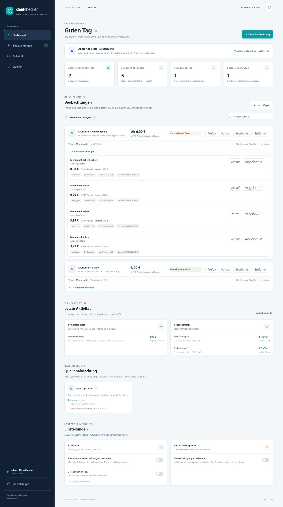

# Prüfbericht — 08.11.2026

## Geprüfter Umfang

Windows, Python 3.14.6, separate Projekt-venv mit `requirements.lock`. Quellcode auf `feature/local-mvp` im bestehenden Repository Yuugel/DealChecker. Das Projekt war zu Beginn leer. Kern/Adapter wurden mit Sol, die Oberfläche mit Luna in isolierten Git-Worktrees implementiert; Integration und Live-Prüfung erfolgten im Hauptcheckout. Ein unabhängiger Sol-Reviewer hat Kern, Sicherheit, Datenquellen und Oberfläche geprüft. Seine konkreten Befunde wurden korrigiert; die abschließende Prüfung der Korrekturen hatte keine verbleibenden Befunde im geprüften Umfang.

## Automatisierte Prüfung

- `python -m pytest -q`: **83 bestanden**, keine Fehlschläge. Eine Deprecation-Warnung aus Starlettes TestClient empfiehlt künftig `httpx2`; sie betrifft den Testclient, nicht den laufenden Dienst.
- `python -m compileall -q dealchecker`: erfolgreich.
- `node --check dealchecker/static/app.js`: erfolgreich.
- `git diff --check`: erfolgreich.

Die Tests prüfen tatsächliche Komponenten gegen synthetische Quellantworten: CRUD und SQLite-Neustart; Schema-Migrationen 1→2→3; atomare Beobachtungen/Ereignisse; Deduplizierung wiederholter Quellzeitpunkte; Preisrückgänge/Wunschpreise/Versand/Nullpreise; Produktidentitäten und mehrere Händler; Quellenfehler und veraltete/nicht mehr gefundene Angebote; Scheduler, Backoff, Parallelitätsbegrenzung, Pause und Black-Friday-Modus; Discord-Payload, Zustellfehler und Serialisierung; HTTPS/DNS/Redirect/Antwortgrößen-Grenzen; lokale Host-/Origin-/JSON-Eingabegrenzen und Prozesssperre.

Keine synthetischen Angebote sind in der normalen Adapterregistrierung verfügbar.

## Reale Windows- und Quellenprüfung

Der Start über `python -m dealchecker --port 8766` und anschließend über `scripts/start.ps1 -Port 8766` funktionierte. Health-API und Browseroberfläche waren über Loopback erreichbar. Der temporäre Prüfport ist nicht der Standardport 8765.

Mit dem tatsächlichen `SafeHttpClient` und Apple-Adapter wurde live abgefragt:

- Exakte deutsche App-Store-ID **728293409**: „Monument Valley“, **399 EUR-Cent**, digitale Lieferung ohne Versandkosten. Bei einem Test-Wunschpreis von 500 Cent entstand genau ein lokales Ereignis.
- Neue dynamische Suche „Monument Valley“, Gesamtpreisgrenze 1000 Cent: **vier passende Treffer**, darunter Monument Valley, Monument Valley 2, Monument Valley 3 und Monument Valley Stickers. Zwei der Treffer meldeten einen Downloadpreis von 0 Cent. Die Suche griff auf die Quelle zu und bestand nicht aus gespeicherten URLs.
- Zusammen ergaben beide Überwachungen fünf gespeicherte Angebotszeilen. Die doppelte Monument-Valley-Zeile gehört zu zwei verschiedenen Überwachungen; innerhalb eines Auftrags wird dedupliziert.
- Nach Beenden und Neustarten wurden die Prüfaufträge automatisch erneut verarbeitet. Für diesen gezielten Neustarttest wurden ausschließlich in der isolierten Prüfdatenbank die Fälligkeiten vorab auf „überfällig“ gesetzt. Danach: zwei Überwachungen, fünf frische Angebote, vier Prüfprotokolle, weiterhin **ein** Ereignis und zwei unterschiedliche reale Beobachtungszeitpunkte pro Angebot.

Das beweist aktuelle Preisabfrage, Speicherung, Scheduler-Wiederaufnahme und unveränderte-Preis-Deduplizierung. **Eine echte Händlerpreisänderung während des Testfensters wurde nicht beobachtet.** Die Erkennung geänderter Preise wurde kontrolliert in automatisierten Tests nachgewiesen.

Live-Prüfdaten und JSON-Ergebnisse liegen lokal im ignorierten `artifacts/`-Ordner. Frühere Prüfstände unter `artifacts/live-check` bleiben als Entwicklungsbelege erhalten; der korrigierte Abschlusslauf liegt unter `artifacts/live-verified`. Diese Daten werden nicht als Benutzerbestand vorinstalliert und nicht nach GitHub hochgeladen.

## Browserprüfung

Im In-App-Browser auf dem lokalen Windows-Dienst geprüft:

- Dashboard und vorhandener Wunschpreisalarm sichtbar.
- Dynamischen Auftrag im Formular anlegen, echtes Suchergebnis abrufen und Preisgrenze bearbeiten.
- Alle vier Discovery-Angebote aufklappen: individuelle Namen, Händler, Preise, sichere Links und separate Verlaufsaktionen sichtbar.
- Einzelverlauf trägt den richtigen Produktnamen. Bei einer Beobachtung wird ausdrücklich auf unzureichende Daten für eine Kurve hingewiesen; bei mehreren Beobachtungen wird eine Kurve plus Datentabelle angezeigt.
- Daten blieben nach Prozessneustart sichtbar; kein erneuter Alarm bei unverändertem Preis.
- Schmale Ansicht bei 390×844 getestet: kein horizontaler Seitenüberlauf. Temporäre Viewport-Vorgabe anschließend zurückgesetzt.
- Browserkonsole im Abschlusslauf: keine erfassten Fehler oder Warnungen.

## Bekannte Grenzen / offene Abnahmen

- **Abdeckung:** Apple App Store DE ist die einzige sofort nutzbare reale Standardquelle. Der generische Feedadapter ist mit synthetischen Händlerkatalogen getestet; kein echter physischer Händlerfeed wurde eingerichtet. Amazon/MediaMarkt/Saturn/OTTO/idealo/Geizhals/Keepa/mydealz sind nicht als fertige Verbraucheradapter angebunden.
- **Discord:** Funktionsfähiger Webhook-Kanal und dauerhafte Warteschlange implementiert und transportseitig isoliert getestet. Keine Zugangsdaten vorhanden, daher keine echte Nachricht versendet und keine externe Zustellung behauptet.
- **Linux/Raspberry Pi:** portable Implementierung und Windows/Linux-CI vorgesehen; kein Raspberry-Pi-Deployment durchgeführt. Den aktuellen CI-Status im Pull Request prüfen.
- **Betrieb:** kein mehrtägiger Dauerlauf, Lasttest mit sehr großen Katalogen oder menschliche Langzeitabnahme. SQLite-Historien wachsen mit der Nutzungsdauer; Archivierung/Retention ist noch nicht automatisiert.
- **Suche/Bewertung:** keine globale Internetsuche, keine semantische Merkmalsprüfung, kein belastbarer Marktpreis außerhalb der eigenen Beobachtungen. Apple liefert maximal 50 Treffer pro Discovery-Begriff und hat einen 300-Sekunden-Cache. Nicht bepreiste Arcade-/Aboeinträge, In-App-Käufe und Abopreise fehlen bewusst.
- **Feeds:** nur endliche öffentliche autorisierte EUR-JSON-Kataloge; keine authentifizierten Partnerfeeds, automatische Gutscheinanwendung oder Packungsnormalisierung. Ein Feed kann nur die Qualität seiner gelieferten Angaben wiedergeben.
- **Benachrichtigungen:** Ereignisse sind dedupliziert; externe Zustellung ist nach einem Absturz mindestens-einmal, nicht exakt-einmal.

## Nächste sinnvolle Erweiterungen

Einen autorisierten deutschen Händlerfeed oder eBay-Browse-Zugang einrichten, danach reale Abdeckung und Variantenqualität testen. Anschließend einen mehrtägigen Lauf mit einem vom Nutzer konfigurierten Discord-Webhook durchführen. Weitere Adapter erst auf Basis nachgewiesener Zugangsrechte ergänzen; Telegram, Packungsnormalisierung und Archivierung bleiben getrennte Erweiterungen.
